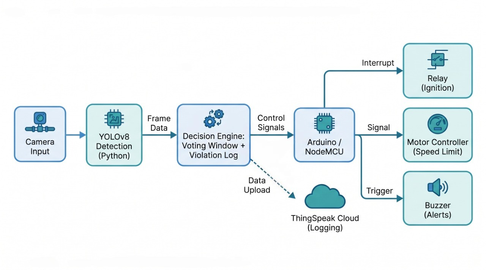
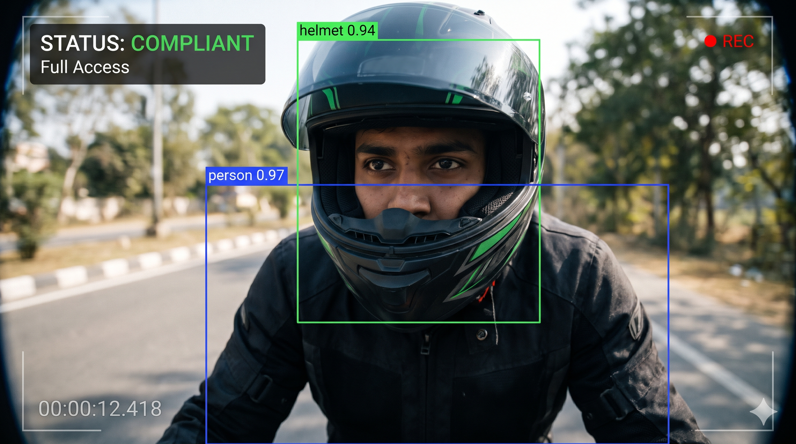
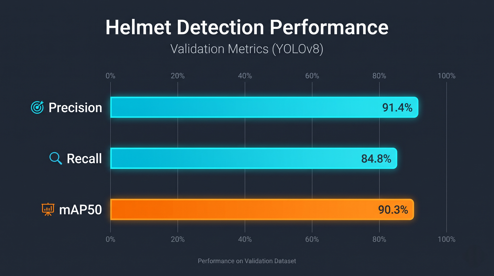

# Intelligent Helmet Enforcement for Two-Wheelers

A computer vision safety prototype that checks whether a motorcycle rider is wearing a helmet before the engine starts and keeps checking while the bike is ridden. A YOLOv8 model runs on a handlebar-mounted camera feed. Based on the result, a microcontroller controls ignition and speed, and the system can log compliance data to ThingSpeak for fleet monitoring.

> **Status: prototype.** This project is not certified for road use. See [Project Status](#project-status) for what is implemented and what is planned.



---

## Table of Contents

- [How It Works](#how-it-works)
- [Project Status](#project-status)
- [System Architecture](#system-architecture)
- [Project Structure](#project-structure)
- [Model and Classes](#model-and-classes)
- [Installation](#installation)
- [Hardware Setup](#hardware-setup)
- [Microcontroller Code](#microcontroller-code)
- [Running the Application](#running-the-application)
- [Results](#results)
- [Troubleshooting](#troubleshooting)
- [Safety and Deployment Notes](#safety-and-deployment-notes)
- [Future Work](#future-work)
- [Author](#author)

---

## How It Works

The system has two operating modes.

### Mode 1: Local Real-Time Enforcement (Serial)

Run with `main.py`. The Python script connects to the microcontroller over USB serial.

1. The camera detects a `person`, which starts a 10-second detection window.
2. If a helmet is detected at any point in the window, the script sends `1`. The microcontroller enables the ignition relay and the rider gets full access.
3. If the window expires with no helmet detected, the script sends `0`. The ignition stays disabled and the buzzer sounds an alert.

### Mode 2: Cloud Logging and Compliance Analytics (ThingSpeak)

Run with `thingspeak.py`. This mode samples frames over a 10-second window and uses voting to make a stable decision.

1. The script calculates the ratio of frames in which a helmet was detected.
2. If a person is present and the ratio is above 50%, the session is marked compliant (`field1 = 1`, `field2 = 0`).
3. Otherwise, it is marked non-compliant (`field1 = 0`, `field2 = 1`).
4. The result is sent to a ThingSpeak channel for remote audits and fleet analytics.

### Escalation Logic

Repeated violations are handled in stages:

| Violation | Response | Status |
|---|---|---|
| 1st | Warning (buzzer alert) | Implemented |
| 2nd | Speed restriction to 10-15 km/h, up to 3 km | Implemented (speed control via motor controller) |
| 3rd | Controlled stop after a 500 m to 1 km allowance, then immobilization for 36-48 hours | Planned |

The violation count resets after three months.

---

## Project Status

**Implemented**

- YOLOv8 helmet detection model trained on a custom 13-class dataset
- 10-second helmet check before ignition
- Serial link from Python to Arduino / NodeMCU
- Relay control for enabling and disabling ignition
- Buzzer alerts for compliance and violations
- Rolling voting window for ongoing compliance decisions
- First-violation warning
- Second-violation speed restriction through the motor controller
- ThingSpeak compliance logging

**Planned**

- Third-violation controlled stop and 36-48 hour immobilization
- 500 m to 1 km distance allowance before lock, with the rider required to move the vehicle off main roads
- Distance measurement for the 3 km restriction (wheel sensor with timer, or GPS)
- Automated three-month reset of the violation log
- Manual hardware override switch

Brakes are not locked while the vehicle is moving. Immobilization is applied only after the vehicle has come to a controlled stop.

---

## System Architecture

```
Handlebar Camera → YOLOv8 Inference (Python)
                          │
         ┌────────────────┴────────────────┐
         ▼ (Option 1: Serial)              ▼ (Option 2: Cloud)
   PySerial Link                     ThingSpeak IoT Cloud
         │                                 │
         ▼ (USB Serial)                    ▼ (WiFi polling)
  Arduino / ESP8266 (NodeMCU) ◄────── ESP8266 (NodeMCU)
         │
         ├──► Relay Module ──► Ignition Control
         ├──► Motor Controller ──► Speed Limit
         └──► Buzzer ──► Driver Alerts
```

---

## Project Structure

```
.
├── main.py                              # Real-time detection with serial control
├── thingspeak.py                        # Voting-based detection with ThingSpeak logging
├── best.pt                              # Trained YOLOv8 weights
├── Helmet_Detection_using_Yolo.ipynb    # Dataset download and training notebook (Google Colab)
├── requirements.txt                     # Python dependencies
├── docs/                                # Architecture diagrams and output images
└── .gitignore
```

---

## Model and Classes

The model (`best.pt`) was trained on a custom dataset from Roboflow for 50 epochs on a Tesla T4 GPU in Google Colab.

| Class ID | Class Name | Category | Action in System |
|---|---|---|---|
| 0 | Cycling Helmet | Helmet / Safe | `SAFE_IDS` (passes check) |
| 1 | half face | Helmet / Safe | `SAFE_IDS` (passes check) |
| 2 | hard hat | Helmet / Safe | `SAFE_IDS` (passes check) |
| 3 | helmet | Helmet / Safe | `SAFE_IDS` (passes check) |
| 4 | modular helmet | Helmet / Safe | `SAFE_IDS` (passes check) |
| 5 | motorbike | Vehicle | Ignored (context) |
| 6 | motorcyclist | Person on bike | Ignored (context) |
| 7 | without-helmet / no-helmet | Violator | Triggers non-compliance |
| 8 | nutshell | Helmet / Safe | `SAFE_IDS` (passes check) |
| 9 | person | Driver | `PERSON_ID` (starts detection window) |
| 10 | plate | License plate | Ignored (context) |
| 11 | quarter face helmet | Helmet / Safe | `SAFE_IDS` (passes check) |
| 12 | sports helmet | Helmet / Safe | `SAFE_IDS` (passes check) |

---

## Installation

### 1. Clone the repository

```bash
git clone https://github.com/mohammedraiyan05/INTELLIGENT-HELMET-DETECTION-WITH-AUTOMATED-VEHICLE-CONTROL-USING-COMPUTER-VISION.git
cd INTELLIGENT-HELMET-DETECTION-WITH-AUTOMATED-VEHICLE-CONTROL-USING-COMPUTER-VISION
```

### 2. Create a virtual environment

```bash
python -m venv helmet_env
```

### 3. Activate it

**Windows (PowerShell):**
```powershell
.\helmet_env\Scripts\Activate.ps1
```

**Windows (CMD):**
```cmd
helmet_env\Scripts\activate.bat
```

**macOS / Linux:**
```bash
source helmet_env/bin/activate
```

### 4. Install dependencies

```bash
pip install -r requirements.txt
```

---

## Hardware Setup

### Components

- Arduino or ESP8266 NodeMCU
- 5V relay module (ignition control)
- Active buzzer
- USB webcam or handlebar-mounted camera
- Motor controller with speed-limit input (for the speed restriction stage)

### Wiring (NodeMCU)

```
NodeMCU ESP8266         Relay Module
┌─────────────┐        ┌────────────┐
│         3V3 ├───────► VCC        │
│         GND ├───────► GND        │
│          D1 ├───────► IN         │
└─────────────┘        └────────────┘
                         │   ┌──────┐
                         └───┤ NO   ├────► Ignition Circuit Line 1
                             │ COM  ├────► Ignition Circuit Line 2
                             └──────┘

NodeMCU ESP8266         Active Buzzer
┌─────────────┐        ┌────────────┐
│          D2 ├───────► POSITIVE   │
│         GND ├───────► NEGATIVE   │
└─────────────┘        └────────────┘
```

Check the relay module's voltage rating before connecting. Do not connect the relay to a vehicle's ignition circuit without the safety measures described below.

---

## Microcontroller Code

Two Arduino sketches are provided. Use the one that matches the mode you run.

### Sketch 1: Serial Receiver (for `main.py`)

Reads `1` or `0` from USB serial and sets the relay and buzzer.

```cpp
// Serial Control for Vehicle Ignition
const int relayPin = D1;  // GPIO5 (Pin D1 on NodeMCU)
const int buzzerPin = D2; // GPIO4 (Pin D2 on NodeMCU)

void setup() {
  Serial.begin(9600);
  pinMode(relayPin, OUTPUT);
  pinMode(buzzerPin, OUTPUT);

  // Start with the relay open (vehicle disabled)
  digitalWrite(relayPin, LOW);
  digitalWrite(buzzerPin, LOW);
}

void loop() {
  if (Serial.available() > 0) {
    char signal = Serial.read();

    if (signal == '1') {
      // Helmet detected: enable ignition
      digitalWrite(relayPin, HIGH);

      // Confirmation beep
      digitalWrite(buzzerPin, HIGH);
      delay(400);
      digitalWrite(buzzerPin, LOW);

      Serial.println("Ignition ENABLED");
    }
    else if (signal == '0') {
      // No helmet: keep vehicle disabled
      digitalWrite(relayPin, LOW);

      // Rapid alert beeps
      for (int i = 0; i < 4; i++) {
        digitalWrite(buzzerPin, HIGH);
        delay(150);
        digitalWrite(buzzerPin, LOW);
        delay(150);
      }

      Serial.println("Ignition DISABLED");
    }
  }
}
```

### Sketch 2: ThingSpeak Polling Subscriber (for `thingspeak.py`)

Connects to WiFi and polls the ThingSpeak channel every 15 seconds to read the latest compliance state.

```cpp
#include <ESP8266WiFi.h>
#include <ESP8266HTTPClient.h>
#include <WiFiClient.h>

// WiFi configuration
const char* ssid = "YOUR_WIFI_SSID";
const char* password = "YOUR_WIFI_PASSWORD";

// ThingSpeak configuration
const char* channelID = "YOUR_CHANNEL_ID";     // e.g. "2489812"
const char* readAPIKey = "YOUR_READ_API_KEY";  // Optional if the channel is public

// Hardware pins
const int relayPin = D1;
const int buzzerPin = D2;

// Polling interval (ThingSpeak allows about one read every 15 seconds)
unsigned long lastTime = 0;
const unsigned long timerDelay = 15000;

void setup() {
  Serial.begin(115200);
  pinMode(relayPin, OUTPUT);
  pinMode(buzzerPin, OUTPUT);
  digitalWrite(relayPin, LOW);

  WiFi.begin(ssid, password);
  Serial.print("Connecting to WiFi");
  while (WiFi.status() != WL_CONNECTED) {
    delay(500);
    Serial.print(".");
  }
  Serial.println("\nConnected to WiFi");
}

void loop() {
  if ((millis() - lastTime) > timerDelay) {
    if (WiFi.status() == WL_CONNECTED) {
      WiFiClient client;
      HTTPClient http;

      // Last value of Field 1 (helmet compliance state)
      String url = "http://api.thingspeak.com/channels/" + String(channelID) + "/fields/1/last.txt";

      http.begin(client, url);
      int httpResponseCode = http.GET();

      if (httpResponseCode > 0) {
        String payload = http.getString();
        payload.trim();
        Serial.print("ThingSpeak Field 1 value: ");
        Serial.println(payload);

        if (payload == "1") {
          digitalWrite(relayPin, HIGH);
          Serial.println("Compliance OK: relay ON");
        } else if (payload == "0") {
          digitalWrite(relayPin, LOW);
          Serial.println("Safety alert: relay OFF");
        }
      } else {
        Serial.print("HTTP error code: ");
        Serial.println(httpResponseCode);
      }
      http.end();
    } else {
      Serial.println("WiFi disconnected");
    }
    lastTime = millis();
  }
}
```

---

## Running the Application

### Mode 1: Local Real-Time Enforcement

1. Connect the Arduino or NodeMCU over USB.
2. Find the COM port (for example `COM6` on Windows, `/dev/ttyUSB0` on Linux).
3. In `main.py`, set the port on the line that opens the serial connection:
   ```python
   arduino = serial.Serial('COM6', 9600)  # Set your COM port here
   ```
4. Run:
   ```bash
   python main.py
   ```
5. Face the camera. The script waits for a person, then checks for a helmet for 10 seconds. A helmet sends `1` and enables the ignition. No helmet sends `0` and the script exits.

### Mode 2: Cloud Reporting (ThingSpeak)

1. Create a channel on [ThingSpeak](https://thingspeak.com).
2. Enable **Field 1** (helmet compliance: 1 = helmet worn, 0 = not worn) and **Field 2** (non-compliance: 1 = not worn, 0 = worn).
3. Copy your Write API Key.
4. In `thingspeak.py`, set the key on the line that defines it:
   ```python
   THINGSPEAK_API_KEY = "YOUR_WRITE_API_KEY"
   ```
   Do not commit this key to Git. See [Safety and Deployment Notes](#safety-and-deployment-notes).
5. Run:
   ```bash
   python thingspeak.py
   ```
6. The script runs for 10 seconds, calculates the compliance ratio, prints it, and updates the ThingSpeak channel.

---

## Results

<!-- Replace the placeholders below with your measured values and test details. -->

| Metric | Value |
|---|---|
| Precision | [add value] |
| Recall | [add value] |
| mAP50 | [add value] |
| Frames per second (inference) | [add value] |
| Hardware used | [add value] |
| Test conditions | [add value] |





---

## Troubleshooting

| Problem | Cause | Solution |
|---|---|---|
| `SerialException: could not open port` | Wrong COM port, or the port is in use by another program such as the Arduino Serial Monitor. | Check the port in Device Manager or the Arduino IDE. Close the Serial Monitor before running the script. |
| `best.pt` not found | Model file is not in the project root. | Make sure `best.pt` is in the same folder as `main.py`. |
| `cv2.error: OpenCV ...` | Camera permissions are blocked, or the camera index is wrong. | Check the camera connection. For an external USB camera, change `cv2.VideoCapture(0)` to `cv2.VideoCapture(1)` or `2`. |
| Connection timeouts to ThingSpeak | No internet access, or a firewall is blocking requests. | Check the internet connection and verify the Write API key. |
| Relay does not switch | Wrong GPIO pin or voltage mismatch. | Make sure the pin in the sketch matches the wiring (for example `D1`). Power the relay module at the voltage it specifies. |

---

## Safety and Deployment Notes

This is a prototype. Please read these notes before connecting any part of it to a real vehicle.

- **Manual override.** Any real installation must include a physical switch on the dashboard that bypasses the relay, so a fault never prevents a rider from getting home or reaching help.
- **Fail-safe default.** When the system cannot confirm compliance, it should keep the vehicle restricted, not grant full access.
- **Vehicle safety standards.** Integration with real ignition, power, or braking systems must follow functional safety guidelines such as ISO 26262. This project has not been certified for road use.
- **Controlled stops.** Immobilization must only be applied after the vehicle has stopped. Locking brakes on a moving vehicle is not a supported behavior.
- **Credentials.** Keep API keys out of version control. Load them from a `.env` file using `python-dotenv`, and add `.env` to `.gitignore`.
- **Privacy.** The system is designed to log compliance results rather than raw video. A deployed system would need a clear data policy covering storage, retention, access, and rider notification.

---

## Future Work

- Third-violation controlled stop and 36-48 hour immobilization
- Distance measurement for the 3 km restriction
- Automated three-month violation reset
- Hardware override switch
- Better low-light performance (infrared illumination or a low-light camera)
- More training data across helmet types, lighting conditions, and camera angles
- Testing on a closed track before any road trial

---

## Author

**Mohammed Raiyan A**
Final Year Project, Computer Science and Engineering
C. Abdul Hakeem College of Engineering & Technology

- Portfolio: [mdraiyan.ct.ws](https://mdraiyan.ct.ws)
- LinkedIn: [linkedin.com/in/mohammed-raiyan21](https://linkedin.com/in/mohammed-raiyan21)

